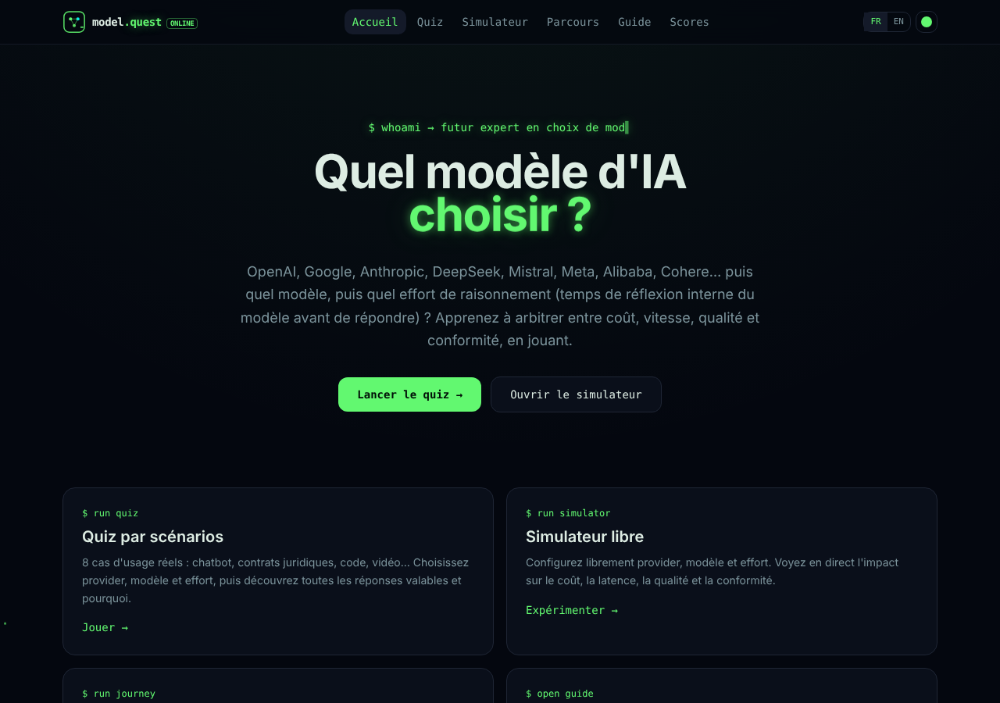

# model.quest

[](https://github.com/gspch/model-quest/actions/workflows/ci.yml)
[](LICENSE)


[Français](README.md) | English

A game to learn how to choose an AI provider, a model and its reasoning effort (the internal thinking time before answering). No real model calls: you compare cost, speed, quality and compliance.



## Features

- 8-scenario quiz with several defensible answers (64 points maximum).
- Cost, latency, quality and effort simulator with an input/output split.
- 4-level journey: provider, model, effort, full combo.
- Guide to 8 providers and 23 models, data verified on October 21, 2026.
- Optional online leaderboard and shareable PNG badge.
- FR/EN interface, 4 visual themes, promotional prices that expire automatically.

## Quick start

```sh
nvm use            # Node 22
npm install
npm run dev        # http://localhost:5173
```

`npm run check` runs format check, lint, typecheck and tests. `npm run build` outputs to `.output/`.

## Stack

TanStack Start (SSR) and Router, React 19, strict TypeScript, Tailwind CSS v4, Vite 8, Vitest, Supabase (optional leaderboard).

## Updating data

See [CONTRIBUTING.md](CONTRIBUTING.md) (in French). In short: edit `src/data/models.ts` and `src/data/en.ts`, bump the date in `src/data/sources.ts`, run `npm test`.

## Optional leaderboard

Create a Supabase project, apply `supabase/migrations` in order, then copy `.env.example` to `.env.local` and set `VITE_SUPABASE_URL` and `VITE_SUPABASE_PUBLISHABLE_KEY` (public key only). Without them the app works and the publish form is hidden.

## Deploying

The build uses Nitro. Pick a target with `NITRO_PRESET`, for example `NITRO_PRESET=vercel npm run build`. The default Node server starts with `node .output/server/index.mjs`.

## Known limitations

- Prices and capabilities are indicative. Quality and latency scores are editorial, not benchmarks.
- Effort is simplified to 4 levels, with educational multipliers applied to estimated output only.
- Cache discounts, batch rates, context tiers and time-of-day rates are not computed.
- The leaderboard is self-reported and can be gamed: answers are not verified server-side.

## License

MIT, see [LICENSE](LICENSE). Provider logos belong to their owners.
