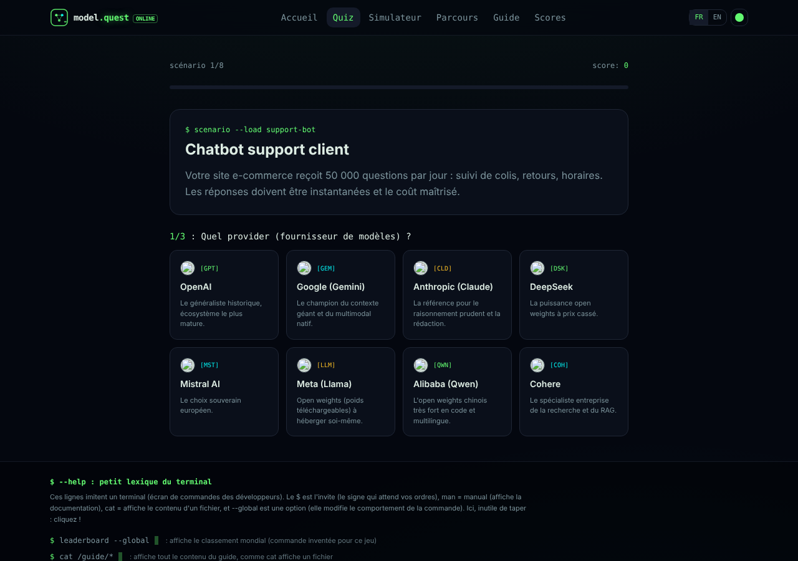
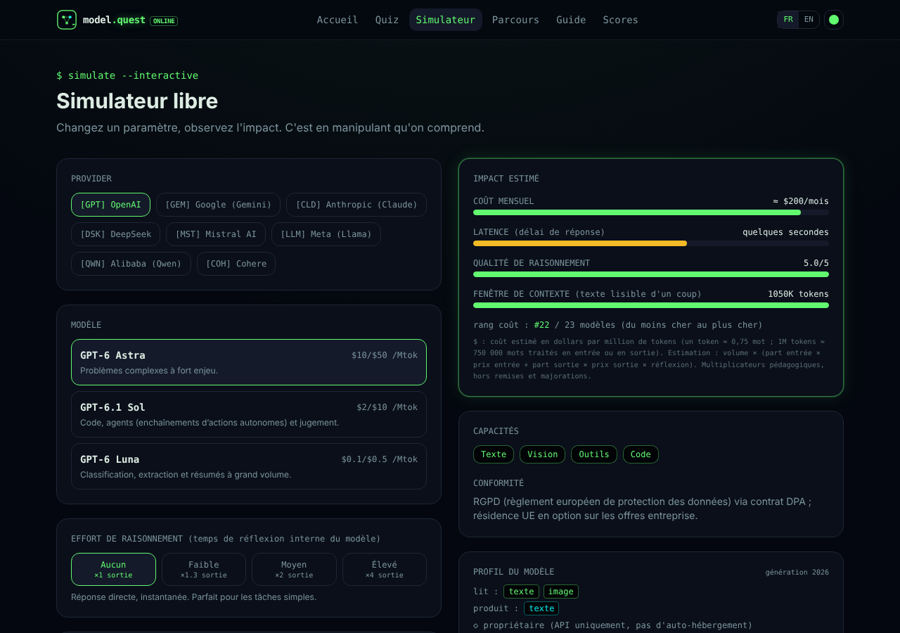

# model.quest

[](https://github.com/gspch/model-quest/actions/workflows/ci.yml)
[](LICENSE)


Français | [English](README.en.md)

Un jeu pour apprendre à choisir un fournisseur d'IA, un modèle et son effort de raisonnement (le temps de réflexion interne avant de répondre). Aucun appel réel aux modèles : on compare coût, vitesse, qualité et conformité.


|                                    |                                                |
| ---------------------------------- | ---------------------------------------------- |
|  |  |

## Fonctionnalités

- Quiz de 8 scénarios réels, avec plusieurs réponses défendables (64 points maximum).
- Simulateur de coût, latence, qualité et effort, avec répartition entrée/sortie.
- Parcours en 4 niveaux : fournisseur, modèle, effort, combo complet.
- Guide de 8 fournisseurs et 23 modèles, données vérifiées le 21 octobre 2026.
- Classement en ligne optionnel et badge PNG partageable.
- Interface FR/EN, 4 thèmes visuels, tarifs promotionnels à expiration automatique.

## Démarrer

```sh
nvm use            # Node 22
npm install
npm run dev        # http://localhost:5173
```

| Commande         | Rôle                                            |
| ---------------- | ----------------------------------------------- |
| `npm run check`  | format, lint, typecheck et tests                |
| `npm test`       | 13 tests (données, notation, coûts, classement) |
| `npm run build`  | build de production dans `.output/`             |
| `npm run format` | applique Prettier                               |

## Stack

TanStack Start (SSR) et Router, React 19, TypeScript strict, Tailwind CSS v4, Vite 8, Vitest, Supabase (classement optionnel).

## Structure

```
src/data/          catalogue FR, traductions EN, parcours, sources
src/routes/        accueil, quiz, simulateur, parcours, guide, scores
src/components/    Nav, Footer, ModelCard, Gauge, ShareBadge...
src/lib/           langue, thème, scores locaux, classement
src/test/          intégrité des données, notation, coûts, routage
supabase/migrations/  schéma et contraintes du classement
```

## Mettre à jour les données

Le détail est dans [CONTRIBUTING.md](CONTRIBUTING.md). En bref : modifier `src/data/models.ts` et `src/data/en.ts`, mettre à jour la date dans `src/data/sources.ts`, puis lancer `npm test`.

Sources officielles : [OpenAI](https://openai.com/api/pricing), [Google](https://ai.google.dev/gemini-api/docs/pricing), [Anthropic](https://platform.claude.com/docs/en/about-claude/pricing), [DeepSeek](https://api-docs.deepseek.com/quick_start/pricing), [Mistral](https://mistral.ai/pricing), [Meta](https://llama.developer.meta.com), [Alibaba](https://www.alibabacloud.com/help/en/model-studio), [Cohere](https://cohere.com/pricing).

## Classement en ligne (optionnel)

1. Créer un projet Supabase et appliquer les fichiers de `supabase/migrations` dans l'ordre.
2. Copier `.env.example` vers `.env.local` et renseigner `VITE_SUPABASE_URL` et `VITE_SUPABASE_PUBLISHABLE_KEY` (clé publique uniquement).

Sans configuration, tout fonctionne et le formulaire de publication est masqué.

## Déployer

Le build utilise Nitro. Choisir la cible avec `NITRO_PRESET`, par exemple `NITRO_PRESET=vercel npm run build` ou `NITRO_PRESET=cloudflare-module npm run build`. Par défaut, le serveur Node se lance avec `node .output/server/index.mjs`.

## Limites connues

- Tarifs et capacités indicatifs. Les notes de qualité et de latence sont éditoriales, pas des mesures.
- L'effort est simplifié en 4 niveaux. Ses multiplicateurs sont pédagogiques et ne touchent que la sortie estimée.
- Remises de cache, lots, tranches de contexte et tarifs horaires ne sont pas calculés.
- Le classement est déclaratif et peut être truqué : les réponses ne sont pas vérifiées côté serveur.
- Changer le nombre de scénarios impose de modifier la contrainte `max_score = 64` du classement.

## Licence

MIT, voir [LICENSE](LICENSE). Les logos des fournisseurs appartiennent à leurs titulaires.
